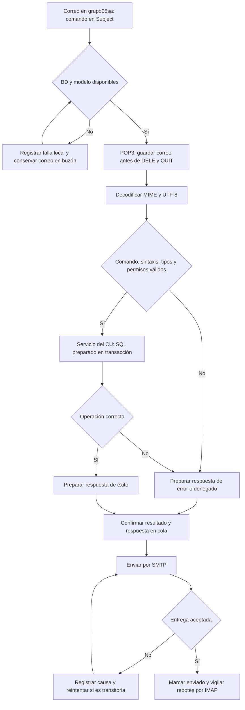

# CRM de captación de prospectos vía e-mail

Proyecto 1 de INF513 Tecnología Web (SA), UAGRM FICCT, gestión 2-2026. Grupo 05 SA:
Lobo Gutierrez Carlos Gabriel, Serrate Basma Leonardo y Vasquez Ardaya Brandon Lider.

El usuario escribe un comando en el **asunto** de un correo a `grupo05sa@tecnoweb.org.bo`, por ejemplo
`VERTABLERO[]` o `MOVERTARJETA["7","Contactado"]`. El sistema lee el buzón por POP3, identifica al remitente por su
correo, comprueba que su rol pueda usar el comando, lo ejecuta en PostgreSQL y le responde con un correo HTML.
`HELP[]` devuelve los comandos de cada rol.

Para retomar el trabajo: [CONTINUAR_P1.md](CONTINUAR_P1.md) reúne las decisiones sobre diagramas,
referencias aprobadas, estado de pruebas y pendientes. [AUDITORIA_ENUNCIADO.md](AUDITORIA_ENUNCIADO.md)
contrasta los requisitos de presentación con sus evidencias y límites.

Las migraciones nuevas todavía **no están aplicadas en Tecnoweb**. Conservar los registros existentes:
leer `BASE_DATOS.md`, detener el lector, respaldar y aplicar los scripts de `sql/migraciones/` con transacción.
`sql/esquema.sql` sirve únicamente para crear una base nueva, no para sustituir la base compartida vigente.

El repositorio está **privado** (verificado el 19/11/2026): un compañero necesita acceso como colaborador.
Publicar el código aquí no cambia la base de Tecnoweb. El acceso público requerido para la entrega sigue pendiente.

## Arquitectura

| Capa | Paquete | Contenido |
|---|---|---|
| Presentación | `presentacion` | `Pop3Client` (sockets, RFC 1939), `SmtpSender` (Jakarta Mail), `Correo` (MIME) |
| Aplicación | `aplicacion` | `CommandParser`, `Command`, `CommandProcessor`, un `RolCommandProcessor` por rol, `ResponseFormatter` |
| Dominio | `dominio.<cu>` | un paquete por caso de uso con su `XService` y sus entidades |
| Persistencia | `persistencia` | `DatabaseService` (JDBC, consultas parametrizadas) |

Casos de uso: CU1 usuarios · CU2 captación y oferta · CU3 asignación · CU4 embudo Kanban · CU5 pérdidas y motivos ·
CU6 validación y conversión a matrícula · CU7 bitácora, interacciones y recordatorios · CU8 reportes.
Roles: `administrador`, `coordinador`, `vendedor` y el remitente no registrado (público).
La matriz de acceso se genera del código con `java -jar target/crm-mail.jar --anexo`.

### Flujo del analizador de correos



Se toleran espacios adicionales y asuntos UTF-8. Dentro de un parámetro entre comillas, una comilla
literal se escribe duplicada: `REGISTRARINTERACCION["7","Nota","Pidió el curso ""Web"""]`.
Las respuestas contienen el resultado o una descripción comprensible del error; las trazas técnicas se
conservan en los logs. Si la BD está caída antes de leer el buzón, se difiere el proceso hasta recuperarla.

## Despliegue

| Pieza | Valor |
|---|---|
| Lectura | POP3 `mail.tecnoweb.org.bo:110` (Dovecot), cuenta `grupo05sa` |
| Respuesta | SMTP `smtp.gmail.com:587` STARTTLS (la facultad no reenvía a dominios externos) |
| Base de datos | PostgreSQL 18.6 `db.tecnoweb.org.bo:5432`, BD `db_grupo05sa`, esquema compartido `public` |
| Ejecución | PC del grupo (Windows 11, JDK 21) con `ejecutar.ps1`; el servicio del VPS (`deploy/crm-mail.service`) quedó deshabilitado como respaldo |
| Log | consola y `logs/crm-mail.N.log` (5 MB x 5): una línea por ciclo y la causa de cada falla |

## Compilar y ejecutar

```sh
mvn package                                   # Java 21+, Maven 3.9; genera target/crm-mail.jar

# Para instalar una base nueva de pruebas, consultar BASE_DATOS.md.
cp crm-mail.properties.example crm-mail.properties   # completar las contraseñas (no se versiona)
java -jar target/crm-mail.jar crm-mail.properties
```

En la PC del grupo (PowerShell), con la configuración privada en `..\.secrets\crm-mail.properties`:

```powershell
.\ejecutar.ps1                # servicio: revisa el buzón cada 10 s (Ctrl+C para detener)
.\ejecutar.ps1 -Diagnostico   # solo revisa DNS, puertos, POP3, SMTP y la BD (IP vista por PostgreSQL, tablas, permisos)
```

Cada ciclo deja una línea (`ciclo 812 OK · BD 42 ms · POP3 0 msg 310 ms`). Ante una falla, el log nombra la etapa, el
destino y la causa probable (DNS, puerto cerrado, IP fuera de `pg_hba.conf`, clave cambiada, tabla borrada, permiso
revocado, buzón bloqueado por otro lector, clave de aplicación de Gmail revocada); mientras sigue, una línea corta por
ciclo, y al volver, `RECUPERADO` con su duración. La traducción está en `Diagnostico.java` (prueba: `DiagnosticoTest`).
Si la BD no responde o le faltan tablas, el ciclo no retira mensajes del buzón: se atienden cuando vuelve.

### Bandeja persistente (19/11/2026)

La versión nueva guarda cada correo en `log_comandos` antes de borrarlo del buzón. El procesamiento de negocio,
el resultado y la respuesta pendiente se confirman en una misma transacción. `correos_salientes` conserva el
mensaje MIME para reintentar su envío sin repetir la operación. Un reintento conserva su Message-ID; si el SMTP
aceptó el mensaje pero perdió la confirmación, el destinatario puede recibir otra copia de esa misma respuesta.
Los logs distinguen `RECIBIDO`, `CONFIRMADO`, `PENDIENTE`, `ENVIADO` y `FALLIDO`.

**La migración de esta versión todavía no está aplicada a producción.** Consultar
[BASE_DATOS.md](BASE_DATOS.md#bandeja-de-entrada-y-salida-del-correo-19112026--pendiente-de-aplicar).
El JAR nuevo no procesa el buzón si falta la estructura requerida. No ejecutar el SQL de instalación sobre la
base vigente. Las pruebas locales y sus límites están en [PRUEBAS.md](PRUEBAS.md#caidas-y-recuperacion).
Si el servidor de un destinatario rechaza una respuesta después de que Gmail la aceptó, el aviso de rebote llega a la
cuenta emisora; cada minuto se lee por IMAP y queda como `REBOTE respuesta a X no entregada → motivo` en el log y en
la bitácora. Si IMAP falla, se avisa una vez y el ciclo sigue.

Si borran tablas o datos, se repone el esquema `public` desde un respaldo (todo o nada, en una sola transacción):

```powershell
.\respaldo.ps1                                          # respaldo en ..\.secrets\respaldos\public_AAAAMMDD_HHMMSS.dump
.\respaldo.ps1 -Restaurar ..\.secrets\respaldos\X.dump  # recrea tablas, claves y datos de ese respaldo
```

Cualquier remitente puede escribir (Gmail, Outlook, `@uagrm.edu.bo`...): el rol se busca por su correo en `usuarios`
y, si no está, actúa como visitante. Se aceptan los prefijos `Re:`/`RV:`/`Fwd:` y las comillas tipográficas.

Prueba sin correo: `java -jar target/crm-mail.jar --probar crm-mail.properties remitente@gmail.com "VERTABLERO[]"`.

## Base de datos y alcance

Ahora se termina **P1 correo**, con los ocho casos de uso aprobados. P2 web sigue en
desarrollo y se continuara despues sobre la misma base y registros. Aunque se comenzo
por web, correo funciona directamente con PostgreSQL y no requiere ejecutar Laravel.
La base vigente es `db_grupo05sa`, esquema `public`.
Estructura e instalacion en una base nueva: [BASE_DATOS.md](BASE_DATOS.md).

- El vendedor no se autoasigna ni ve la bolsa; administracion/coordinacion distribuyen por menor carga.
- Se aceptan los alias En Contacto y Seguimiento; el tablero muestra las seis etapas aprobadas y los pagos pueden gestionarse por correo.
- CU6 permite generar ordenes, adjuntar comprobantes reales, revisar pagos y confirmar inscripciones sin abrir web.
- La conversion consulta la inscripcion confirmada, sin duplicarla; la exportacion CSV prepara el intercambio con SIS.
- `COMPLETARRECORDATORIO["id","resultado"]` exige una nota de cumplimiento.
- El catalogo externo sigue simulado; las referencias iniciales estan en `sql/referencias.sql`.
- El acceso actual de correo identifica al remitente registrado; las claves de acceso web se gestionaran en P2.
- Coordinacion en correo se limita a sus programas (RF1.3); administracion los asigna con `ASIGNARCOORDINADOR`.
- Guia funcional: [GUIA_CORREO_CASOS_APROBADOS.md](GUIA_CORREO_CASOS_APROBADOS.md).
- La API del Grupo 06 todavia no esta disponible: no se realiza una matriculacion automatica en SIS.

Pruebas y preparacion del entorno aislado: [PRUEBAS.md](PRUEBAS.md).
Resumen verificado: `doc/pruebas/integracion-servidor.json` y `PRUEBAS.md`.
Documento PUDS y diagramas EA actualizados el 19/11/2026 sobre el esquema propuesto: `doc/documento_p1.py` y `doc/ea/ea_p1.py`
(las firmas de las clases y el despacho de comandos se leen del código con `doc/ea/firmas.py`).
Para regenerar desde un clon independiente: `python doc/documento_p1.py` (Python con python-docx,
PyMuPDF, Pillow y pywin32). Se incluye la herramienta FICCT en `doc/lib/` y el logo en `doc/recursos/`;
no es necesario que el directorio del clon se llame `p1`. EA requiere su instalación autorizada y la exportación
final requiere Word en Windows. El esquema y el código Java no dependen de esas herramientas documentales.
Después de generar el DOCX, `scripts/exportar_documento.ps1` exporta DOC y PDF con Word real, sustituye los PNG
por sus EMF cuando existen y actualiza los índices después de convertir al formato DOC. Se mantiene un único
diagrama de secuencia por caso de uso, sin vistas adicionales de detalle del CU6.

Los modelos de dominio inicial, conceptual, lógico, canal de correo, arquitectura y componentes tienen vistas
globales. El conceptual y el lógico muestran las 25 tablas propuestas en una sola figura por nivel. Cada CU
conserva un procedimental completo, incluyendo las clases compartidas con sus miembros visibles.
`scripts/auditar_modelos.py` los coteja contra un PostgreSQL desechable, sin acceder a producción.
`scripts/laminas_uml.py` genera `doc/P1-LAMINAS-UML-GRUPO05SA.pdf`: las mismas figuras vectoriales completas,
ampliadas para lectura o impresión. No divide diagramas ni cambia el formato carta del informe principal.

El catálogo normalizado separa `programas(codigo,nombre)` de sus módulos en `catalogo_cache`.
Se mantienen comandos, códigos, precios e instantáneas comerciales. Tanto la migración de bandeja como
`sql/migraciones/2026-11-19_normalizar_catalogo.sql` están pendientes en producción; el JAR nuevo
valida ambas antes de leer el buzón. Ver instrucciones y reversión en `BASE_DATOS.md`.
P2 deberá adaptar sus consultas a la columna retirada antes de usar este esquema; `crm-web/` no se modificó.
