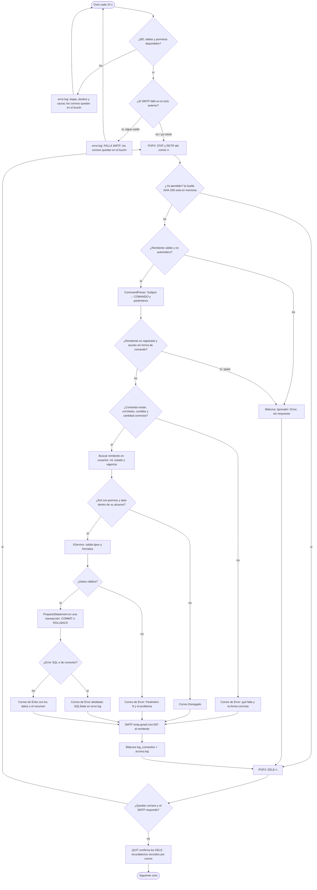

# CRM de captación de prospectos vía e-mail

Proyecto 1 de INF513 Tecnología Web (SA), UAGRM FICCT, gestión 2-2026. Grupo 05 SA:
Lobo Gutierrez Carlos Gabriel, Serrate Basma Leonardo y Vasquez Ardaya Brandon Lider.

El usuario escribe un comando en el **asunto** de un correo a `grupo05sa@tecnoweb.org.bo`, por ejemplo
`VERTABLERO[]` o `MOVERTARJETA["7","En Contacto"]`. El sistema lee el buzón por POP3, identifica al remitente por su
correo, comprueba que su rol pueda usar el comando, lo ejecuta en PostgreSQL y le responde con un correo HTML.
`HELP[]` devuelve los comandos de cada rol. Todo parámetro va entre comillas dobles; dentro de un parámetro una
comilla se escribe `""` o `\"`.

## Arquitectura

| Capa | Paquete | Contenido |
|---|---|---|
| Presentación | `presentacion` | `Pop3Client` (sockets, RFC 1939), `SmtpSender` (Jakarta Mail), `Correo` (MIME) |
| Aplicación | `aplicacion` | `CommandParser`, `Command`, `CommandProcessor`, un `RolCommandProcessor` por rol, `ResponseFormatter` |
| Dominio | `dominio.<cu>` | un paquete por caso de uso con su `XService` y sus entidades |
| Persistencia | `persistencia` | `DatabaseService` (JDBC, consultas parametrizadas) |

Casos de uso: CU1 usuarios · CU2 captación y oferta · CU3 asignación · CU4 embudo Kanban · CU5 pérdidas y motivos ·
CU6 validación y conversión a matrícula · CU7 bitácora, interacciones y recordatorios · CU8 reportes.
Roles: `administrador`, `coordinador`, `vendedor` y el remitente no registrado (público).
La matriz de acceso se genera del código con `java -jar target/crm-mail.jar --anexo`.

## Diagrama de flujo del analizador de correos

Cada 10 s (`App.ejecutar`), por cada correo del buzón:



Cada correo se responde **antes** de su DELE: si el QUIT falla y el servidor devuelve los mensajes, la huella evita
ejecutarlos dos veces. Si el SMTP cae, no se retiran más correos hasta que vuelva.

## Despliegue

| Pieza | Valor |
|---|---|
| Lectura | POP3 `mail.tecnoweb.org.bo:110` (Dovecot), cuenta `grupo05sa` |
| Respuesta | SMTP `smtp.gmail.com:587` STARTTLS (la facultad no reenvía a dominios externos) |
| Base de datos | PostgreSQL 18.6 `db.tecnoweb.org.bo:5432`, BD `db_grupo05sa`, esquema compartido `public` |
| Ejecución | PC del grupo (Windows 11, JDK 21) con `ejecutar.ps1`; el servicio del VPS (`deploy/crm-mail.service`) quedó deshabilitado como respaldo |
| Log | consola, `logs/access.log` (cada ciclo y cada correo: remitente, comando, resultado) y `logs/error.log` (fallas y excepciones con su causa) |

## Compilar y ejecutar

```sh
mvn package                                   # Java 21+, Maven 3.9; genera target/crm-mail.jar

# Para instalar una base nueva de pruebas, consultar BASE_DATOS.md.
cp crm-mail.properties.example crm-mail.properties   # completar las contraseñas (no se versiona)
java -jar target/crm-mail.jar crm-mail.properties
```

En la PC del grupo (PowerShell), con la configuración privada en `..\.secrets\crm-mail.properties`:

```powershell
.\ejecutar.ps1                # servicio: revisa el buzón cada 10 s (Ctrl+C para detener)
.\ejecutar.ps1 -Diagnostico   # solo revisa DNS, puertos, POP3, SMTP y la BD (IP vista por PostgreSQL, tablas, permisos)
```

Cada ciclo deja una línea en `access.log` (`ciclo 812 OK · BD 42 ms · POP3 0 msg 310 ms · total 360 ms`). Ante una
falla, `error.log` (y la consola) nombra la etapa, el
destino y la causa probable (DNS, puerto cerrado, IP fuera de `pg_hba.conf`, clave cambiada, tabla borrada, permiso
revocado, buzón bloqueado por otro lector, clave de aplicación de Gmail revocada); mientras sigue, una línea corta por
ciclo, y al volver, `RECUPERADO` con su duración (en los dos archivos). La traducción está en `Diagnostico.java`
(prueba: `DiagnosticoTest`). Si la BD no responde, le faltan tablas o le quitaron permisos, el ciclo no retira
mensajes del buzón: se atienden cuando vuelve. Si la BD cae a mitad de un comando, se hace ROLLBACK y el remitente
recibe "Error: no hay conexión con la base de datos".
Si borran tablas o datos, se repone el esquema `public` desde un respaldo (todo o nada, en una sola transacción):

```powershell
.\respaldo.ps1                                          # respaldo en ..\.secrets\respaldos\public_AAAAMMDD_HHMMSS.dump
.\respaldo.ps1 -Restaurar ..\.secrets\respaldos\X.dump  # recrea tablas, claves y datos de ese respaldo
```

Cualquier remitente puede escribir (Gmail, Outlook, `@uagrm.edu.bo`...): el rol se busca por su correo en `usuarios`
y, si no está, actúa como visitante. Se aceptan los prefijos `Re:`/`RV:`/`Fwd:` y las comillas tipográficas.

Prueba sin correo: `java -jar target/crm-mail.jar --probar crm-mail.properties remitente@gmail.com "VERTABLERO[]"`.

## Base de datos y alcance

Ahora se termina **P1 correo**, con los ocho casos de uso aprobados. P2 web sigue en
desarrollo y se continuara despues sobre la misma base y registros. Aunque se comenzo
por web, correo funciona directamente con PostgreSQL y no requiere ejecutar Laravel.
La base vigente es `db_grupo05sa`, esquema `public`.
Estructura e instalacion en una base nueva: [BASE_DATOS.md](BASE_DATOS.md).

### Estructura (24 tablas, 31 claves foráneas, ninguna tabla aislada)

Cada tabla tiene **una** clave primaria con el nombre del diseño (sin campos `id`): claves naturales (`usuarios.correo`,
`prospectos.documento`) o correlativos con nombre (`intereses.nro_tarjeta`, `ordenes_pago.nro_orden`...).

| Área | Tablas (PK) | Relaciones principales |
|---|---|---|
| Usuarios y acceso (CU1) | `roles(nombre)`, `usuarios(correo)` con `fecha_inicio`/`fecha_fin`, `api_tokens(token_hash)` | usuarios → roles |
| Catálogo y captación (CU2) | `programas(codigo)`, `catalogo_cache(codigo)` = módulos, `programas_responsables(programa_codigo)`, `prospectos(documento)` | módulo → programa; responsable → programa y coordinador |
| Embudo, asignación y pérdidas (CU3–CU5) | `intereses(nro_tarjeta)` = tarjeta Kanban, `movimientos_interes(nro_movimiento)`, `motivos_perdida(nombre)` | tarjeta → prospecto, módulo, vendedor y motivo |
| Conversión y pagos (CU6) | `ordenes_pago(nro_orden)`, `orden_pago_descuentos(nro_orden, descuento_codigo)` (N-N con `porcentaje` y `monto`), `descuentos(codigo)`, `pagos(nro_orden)`, `comprobantes_pago(nro_comprobante)`, `solicitudes_compra(nro_solicitud)`, `inscripciones_comerciales(nro_solicitud)`, `comisiones(nro_solicitud)`, `exportaciones(nro_exportacion)`, `configuraciones(clave)` | orden → tarjeta; pago 1–0..1 orden; inscripción y comisión 1–0..1 solicitud |
| Seguimiento y bitácora (CU7) | `interacciones(nro_interaccion)`, `recordatorios(nro_recordatorio)`, `log_comandos(nro_registro)`, `notificaciones(nro_notificacion)` | → tarjeta y usuario |
| Reportes (CU8) | consultas sobre las tablas anteriores | — |

El nombre de cada programa se guarda una sola vez en `programas` (3FN). `intereses` guarda el módulo y el precio que vio
el interesado al registrarse, y `solicitudes_compra` el precio acordado en la venta (ya con el descuento): son datos
históricos de cada operación, no copias del catálogo. Sin columnas redundantes: ver `BASE_DATOS.md`.

- El vendedor no se autoasigna ni ve la bolsa; administración o coordinación reparten la bolsa con `ASIGNARPROSPECTO` o en turno rotativo (Round-Robin, RF2.3) con `ASIGNARAUTOMATICO`.
- El usuario usa las seis etapas de RF3.2 (Nuevo, En Contacto, Seguimiento, Promesa de Pago, Convertido, Perdido); en
  `intereses.estado` se guardan como Nuevo, Contactado, Interesado, Pago enviado / En revision, Convertido y Perdido.
- CU6 permite generar órdenes, adjuntar comprobantes, revisar pagos, confirmar inscripciones y fijar la comisión
  (`CONFIGURARCOMISION`) sin abrir web.
- La conversión consulta la inscripción confirmada, sin duplicarla; la exportación CSV prepara el intercambio con el SIS.
- `COMPLETARRECORDATORIO["nro_recordatorio","resultado"]` exige una nota de cumplimiento.
- El catálogo externo sigue simulado; las referencias iniciales están en `sql/referencias.sql`.
- El correo identifica al remitente por su dirección (rol, estado y vigencia en `usuarios`); las claves web son del P2.
- Coordinación se limita a sus programas (RF1.3); administración los asigna con `ASIGNARCOORDINADOR`. Fuera de su
  alcance la respuesta es "Denegado".
- Guía funcional: [GUIA_CORREO_CASOS_APROBADOS.md](GUIA_CORREO_CASOS_APROBADOS.md).
- La API del Grupo 06 todavía no está disponible: no se realiza una matriculación automática en el SIS.

Pruebas y preparación del entorno aislado: [PRUEBAS.md](PRUEBAS.md).
Documento PUDS y diagramas EA: `doc/documento_p1.py` y `doc/ea/ea_p1.py` (las firmas de las clases y el despacho de
comandos se leen del código con `doc/ea/firmas.py`).
