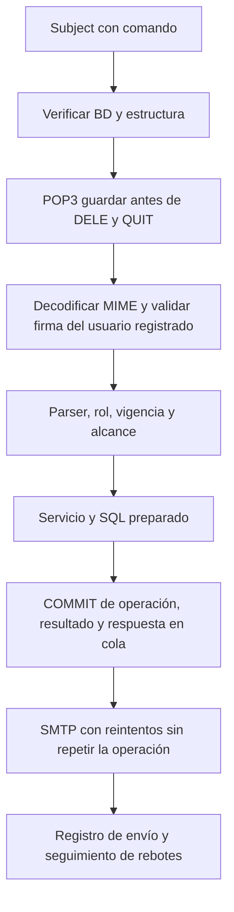

# CRM de captación de prospectos vía e-mail

Proyecto 1 de INF513 Tecnología Web, UAGRM FICCT, gestión 2026-2, Grupo 05 SA.
Integrantes: Lobo Gutierrez Carlos Gabriel, Serrate Basma Leonardo y Vasquez Ardaya Brandon Lider.

El sistema recibe comandos exclusivamente en el Subject, interpreta y valida sus parámetros,
comprueba identidad y permisos, opera sobre PostgreSQL y responde automáticamente por SMTP.
Conserva los ocho casos de uso aprobados y agrega LISPER/INSPER como extensión administrativa de CU1.
No requiere ejecutar P2 web. Ambos proyectos conservan la misma base institucional y sus registros.

## Requisitos

- JDK 21 o posterior; el compilador produce bytecode Java 21 (`maven.compiler.release=21`).
- Maven 3.9 o posterior.
- PostgreSQL 18 para ejecución y pruebas de integración.
- Python 3.8 o posterior para las herramientas locales; python-docx, PyMuPDF, Pillow y pywin32 para documentación.
- Enterprise Architect instalado y autorizado para regenerar UML; Word para exportar DOC/PDF.

Backend Java sin framework web: JDBC PostgreSQL, Angus/Jakarta Mail y jBCrypt. Las dependencias se declaran en pom.xml.

## Arquitectura y estructura

| Capa o recurso | Ubicación | Función |
|---|---|---|
| Orquestación | src/main/java/bo/uagrm/crm | App, Config, ControlSondeo, BucleSondeo, InstanciaCorreo |
| Presentación | presentacion | POP3 propio, MIME, HMAC, bandeja, SMTP e IMAP de rebotes |
| Aplicación | aplicacion | Parser, contratos, permisos por rol y formato de respuestas |
| Dominio | dominio | Ocho CU, pagos y personas del contrato docente |
| Persistencia | persistencia | JDBC preparado, transacciones y verificación del modelo |
| SQL | sql | Instalador de base nueva, referencias, diagnóstico y migraciones |
| Pruebas | src/test/java y scripts | JUnit, integración local y cortes del JAR/PostgreSQL |
| Documentación | doc | PUDS, modelo EA, diagramas y evidencias |
| Despliegue | deploy | Unidad systemd; procedimiento en OPERACION.md |



Si la BD falla antes de descargar, el correo permanece en POP3. Si falla la escritura antes del COMMIT,
se conserva la solicitud recuperable. Si SMTP falla después del COMMIT, se reintenta la respuesta persistida.
Una confirmación SMTP perdida puede producir copias de la misma respuesta; no se promete entrega exactamente una vez.

## Configuración y compilación

```powershell
$env:JAVA_HOME = 'RUTA_JDK_21_O_POSTERIOR'
$env:Path = "$env:JAVA_HOME\bin;$env:Path"
mvn -B package
Copy-Item crm-mail.properties.example RUTA_PRIVADA\crm-mail.properties
.\ejecutar.ps1 -JavaHome $env:JAVA_HOME -Config RUTA_PRIVADA\crm-mail.properties
```

Completar la configuración privada fuera de Git y ZIP. `ejecutar.ps1` rechaza Java anterior a 21.
No ejecutar la aplicación contra la universidad durante una prueba local.

| Servicio institucional | Configuración prevista |
|---|---|
| Buzón | grupo05sa@tecnoweb.org.bo |
| Recepción | mail.tecnoweb.org.bo:110, POP3; capacidades TLS externas pendientes |
| Respuestas | smtp.gmail.com:587, STARTTLS obligatorio |
| Rebotes | imap.gmail.com:993, TLS; solamente seguimiento de respuestas |
| Datos | db.tecnoweb.org.bo:5432/db_grupo05sa, esquema public |

`pop3.seguridad=plain` conserva el servicio conocido; `starttls` exige STLS y `tls` usa TLS implícito.
No hay degradación automática a texto claro. No cambiar puertos sin verificar capacidades con autorización.

## Sondeo y protección de frecuencia

```properties
mail.poll.interval.ms=3000
mail.poll.backoff.max.ms=30000
mail.poll.permanent.retry.ms=60000
```

La espera empieza al terminar el ciclo: no hay solapamiento ni recuperación de ciclos atrasados.
En Tecnoweb se rechaza cualquier valor inferior a 3000 ms. La propiedad histórica `intervalo.segundos`
sigue admitida si falta `mail.poll.interval.ms`; el valor nuevo tiene prioridad.
Los fallos temporales producen esperas 3, 6, 12, 24 y 30 segundos, con la configuración predeterminada.
Los errores permanentes de esquema o credenciales requieren revisión y esperan 60 segundos.
La comprobación de BD ocurre antes del POP3; no se añaden esperas entre sentencias SQL de una transacción.
El control de reconexiones JDBC evita reintentos agresivos después de un fallo.

El bloqueo de archivo por buzón impide arrancar dos lectores en el mismo directorio compartido de bloqueo.
En systemd se utiliza /run/crm-mail. No ejecutar simultáneamente lector PC y VPS: el bloqueo de archivo
es local a la máquina. El responsable debe mantener un solo lector autorizado.
No ejecutar monitores o diagnósticos repetitivos en paralelo. Esta política interpreta el aviso docente
como separación mínima entre sondeos/reintentos; cualquier límite adicional por servicio debe confirmarse.

## Identidad y comandos

From identifica una cuenta candidata; no acredita identidad. Las operaciones de usuarios registrados
requieren firma HMAC-SHA256 con una clave privada individual de al menos 32 bytes, además de rol,
estado y vigencia. Una firma ausente, modificada o sin clave configurada no autoriza la cuenta.
No se confía en Authentication-Results suministrado por un remitente.
Los visitantes conservan exclusivamente los comandos públicos de oferta y registro de interés.

```powershell
python scripts/firmar_correo.py --crear-clave admin@example.test RUTA_PRIVADA\auth-keys.properties
python scripts/firmar_correo.py entrada.eml RUTA_PRIVADA\auth-keys.properties firmado.eml
```

Estas órdenes sólo crean archivos locales: no envían correo. Configurar `auth.keys.file` en el lector y
provisionar cada clave por un canal privado. El cliente que envíe el EML debe conservar las cabeceras
firmadas y el cuerpo MIME. Un correo normal redactado en Gmail sin firma no autoriza operaciones registradas.
El despliegue exige verificar la conservación del mensaje firmado por el trayecto institucional.
La firma admite 24 horas de antigüedad y cinco minutos de desfase futuro. Si una caída o una cola
supera esa ventana, el usuario debe volver a firmar y enviar la solicitud; no ampliar la ventana sin evaluar replay.

Los parámetros de LISPER/INSPER requieren comillas dobles ASCII. Se admiten espacios externos, UTF-8,
comillas literales duplicadas `""` o escapadas con barra inversa. Los comandos CRM conservan su tolerancia
histórica a números/texto sin comillas y comillas tipográficas; no se aplica esa excepción al contrato docente.
Se rechazan comas finales, separadores inválidos y corchetes fuera de parámetros entrecomillados.

```text
LISPER["*"]
INSPER["4715292","Juan Carlos","Perez Seras","Estudiante","33554433","71055123","juanperez@uagrm.edu.bo"]
HELP[]
LISTARUSUARIOS[]
VERTABLERO[]
MOVERTARJETA["7","En Contacto"]
COMPLETARRECORDATORIO["5","Se contactó al prospecto"]
```

LISPER e INSPER sólo están disponibles para administrador activo, vigente y autenticado.
`public.persona` tiene documento, nombres, apellidos, ocupación, teléfono fijo, teléfono celular y correo.
Documento es PK y correo tiene unicidad sin distinguir mayúsculas. No se inventa una FK al CRM.
Los siete campos son obligatorios. Las longitudes y formatos exactos figuran en BASE_DATOS.md;
los teléfonos del contrato docente admiten 7–15 dígitos y un `+` inicial opcional, sin separadores.
Las consultas, inserciones y respuestas vacías o errores utilizan el procesamiento real y la cola SMTP.
Los comandos originales de modificar/eliminar usuarios, prospectos y motivos permanecen disponibles.

Los ocho CU se conservan: usuarios; captación/oferta; asignación; embudo; pérdidas; conversión/pagos;
bitácora/interacciones/recordatorios; reportes. Roles: administrador, coordinador, vendedor y visitante.
La matriz completa se obtiene con `java -jar target/crm-mail.jar --anexo` y está en doc/matriz-acceso.tsv.
La guía de negocio permanece en GUIA_CORREO_CASOS_APROBADOS.md.

## Base de datos y migraciones

Ver BASE_DATOS.md y OPERACION.md. El instalador `sql/esquema.sql` sólo sirve para una base nueva;
rechaza esquemas ocupados. No instalarlo sobre producción ni sustituir registros por referencias de prueba.
Cuando se autorice el despliegue: detener el lector, obtener y comprobar respaldo, ejecutar el diagnóstico
`sql/diagnostico_estructura.sql`, contrastar sus diferencias y aplicar las migraciones necesarias en orden:
bandeja, catálogo y persona. Una cifra de tablas no identifica por sí sola la versión remota.
La versión de persona se registra en configuraciones; no se agrega otra base ni un esquema CRM retirado.
P2 deberá adaptar sus consultas al catálogo normalizado; su código no se modifica en esta tarea.
La API SIS sigue pendiente de su contrato: exportación CSV no significa matrícula automática por API.

## Pruebas reproducibles

```powershell
mvn -B test
python scripts/probar_local.py --java-home RUTA_JDK --defensa
```

La primera orden omite integraciones sin sus variables. La segunda crea PostgreSQL exclusivo en
127.0.0.1, instala datos ficticios, prueba migraciones, dirige todas las suites a QA local y compila el JAR.
Con --defensa también interrumpe el proceso y PostgreSQL de prueba y verifica recuperación.
No lee configuración institucional. Requiere binarios PostgreSQL; se pueden indicar con --pg-bin.
Resultados actuales en doc/pruebas/local-final.json y defensa-local.json; XML JUnit en target/surefire-reports.
Los resultados históricos se conservan identificados como anteriores. Detalles en PRUEBAS.md.

## Logs, operación y solución de problemas

Logs rotativos en logs/crm-mail.N.log, o en /var/log/crm-mail bajo systemd: fecha, etapa,
referencia persistente, resultado y recuperación. Los asuntos y direcciones no se imprimen completos.
`log.directory` y `lock.directory` admiten rutas explícitas; systemd establece sus valores mediante JVM.
Si falta esquema, corregir la migración antes de reiniciar. Si falla conexión, el lector conserva el buzón
y reintenta; si SMTP falla, la operación confirmada no se repite. Un fallo definitivo queda trazable.
No usar `--probar` como diagnóstico de sólo lectura: ejecuta comandos y escribe respuesta.html.
`--diagnostico` puede autenticar servicios reales; usarlo sólo cuando se autorice y sin otro monitor activo.
Procedimiento Linux, permisos, reinicio y recuperación: OPERACION.md.

## Documentación y entrega

PUDS y láminas: doc/P1-INF513-GRUPO05SA.docx, .doc y .pdf; doc/P1-LAMINAS-UML-GRUPO05SA.pdf.
Modelo editable real: doc/ea/crm-p1.eapx; generadores y diagramas en doc/.
Un diagrama de cada tipo por CU, vistas conceptuales y lógicas globales y cuatro secuencias del canal.
Las láminas amplían cada figura completa. No equivalen a fragmentar el modelo.

```powershell
python scripts/preparar_entrega.py
```

Genera ../entrega/2026-2_INF513-P1_grupo05sa.zip por lista permitida con manifiesto, CRC y SHA256.
No publica ni entrega al aula. No incluye credenciales, claves, configuraciones privadas ni logs reales.
El remoto configurado es https://github.com/vangiewz/inf513-proyecto1; su visibilidad actual no se modifica
ni se consulta automáticamente. La última verificación conservada lo identificaba como privado.
CONTINUAR_P1.md registra el estado actual y las acciones externas pendientes.
